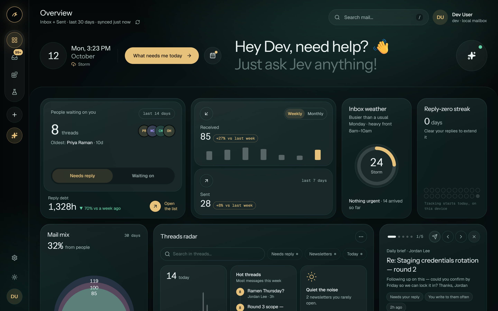

# raven: mail, briefed

[](LICENSE)
[](https://github.com/kleenpulse/raven-mail/actions)
[](https://github.com/sponsors/kleenpulse)

A self-hosted mail client for Gmail, Outlook, Yahoo, iCloud, Fastmail, Proton (Bridge), and any IMAP/SMTP mailbox — with an **Overview** that answers "what needs me?" and **Ask Jev**, an assistant that finds things in your inbox without making anything up.



## Why Raven

- **No password database.** Your mail credentials live only in an encrypted cookie in your browser. Raven never stores them on a server.
- **Jev can't make things up.** Jev is a decision model, not a text generator. It picks from fixed options and every answer cites the emails it came from. See [Jev, honestly](#jev-honestly).
- **Trackers are blocked.** Remote images stay blocked until you click, and emails render in a sandboxed iframe with no scripts.

## What's inside

- **Overview** (`/overview`, the home screen) — replies you owe and who owes you (judged against each person's usual reply time), reply debt with a payoff plan, inbox "weather", received vs sent, mail mix, arrival heatmap turned into suggested check-in times, newsletter open rates (A–F) with unsubscribe links, storage, a daily brief, and a reply-zero streak.
- **Ask Jev** (⌘/Ctrl + K anywhere) — questions like "who's waiting on my reply?", "receipts this month", "anything about the roadmap?". Answers show the emails they came from, how sure Jev is, and exactly what was searched.
- **Mail** (`/mail`) — the three-pane reader: folders, list with previews, and a sandboxed message view.
- **Integrations** (`/integrations`) — step-by-step health checks for your mail account and Jev; Slack, Discord and signed JSON webhooks (Zapier, Make, n8n) for **Share** from the reader and **Send brief** from the Overview; and a resumable **mailbox export** to `.mbox`. Every connect, test and delivery streams its progress and lands in an activity log.
- **Two skins** — *Ember* (light: warm paper, coral) and *Nebula* (dark: deep-teal glass, gold and cyan). The sun/moon button in the rail switches between them.

## Jev, honestly

[Jev](https://docs.typesafe.ai) is TypeSafe's *decision model*: it answers typed questions (pick one of these options, score this, yes/no) and returns probabilities — it does **not** write text. Raven uses it for exactly that:

1. **Understand** — one Jev call picks the intent, time range, and contact from fixed options.
2. **Search** — Raven filters your mail (dates and counts are computed in code, never by the model).
3. **Rank** — for topic searches, Jev picks which candidate emails best answer the question; the probabilities become the ranking.
4. **Answer** — a templated answer plus the cited emails. Low confidence shows "did you mean" chips instead of guessing.

Email text only ever reaches Jev as data to choose between, and Jev can't take actions, so a hostile email can at worst rank itself higher. Each user can bring their own TypeSafe key in **Settings → Account** (it is checked once, then kept only inside the encrypted session cookie, and wins over the server key). **Deep triage** (a button, never automatic) asks Jev to re-score your last 48 hours.

### Kage: the same questions, without a key

Not everyone has a Jev key, so Raven ships **Kage** (`lib/kage/`), a built-in engine that answers Jev's exact `systemOne` contract (`choice`, `score`, `noul`) with no network and no account. It scores each option with BM25 over word stems plus a small mail lexicon ("invoice" ≈ "receipt", "owes me" ≈ "no reply"), turns the scores into probabilities, and like Jev it never writes text: email content is only evidence, so it can't add options or change the question.

- With no key, Ask and Deep triage run on Kage, labelled **Kage** in the UI. If a Jev call fails (bad key, rate limit, outage), Kage answers it instead.
- `KAGE=off` turns it off; then keyless sessions use the keyword rules.
- `bun run eval:kage` (or **Kage** in the dev nav, `/dev/kage`) scores Kage against the keyword rules, and against Jev when `TYPESAFE_API_KEY` works, on labeled fixtures in `test/fixtures/kage/`. The **blind** split was written after tuning stopped. Read that one.

An LLM "narrator" can be plugged in later at `lib/jev/ask/narrate.ts`; none ships today.

## Stack

- **Next.js 16** (App Router) · React 19 · TypeScript · **bun**
- **shadcn/ui** on Base UI + Tailwind CSS v4 (tokens in `app/globals.css`)
- **TanStack Query** (reads via GET route handlers) · **nuqs** (URL state) · **Zustand** (compose, Ask history)
- **imapflow** + **mailparser** to read, **nodemailer** to send
- **@typesafe-ai/sdk** (Jev), with Kage and then keyword heuristics as fallbacks
- **Neon Postgres** + **Drizzle** (integrations only) — `@neondatabase/serverless` over HTTP

## Quick start

```bash
bun install
cp .env.example .env.local
# set SESSION_SECRET (openssl rand -base64 32)
bun run dev
```

Integrations need a Postgres database (everything else runs without one). With Neon: `neon env pull` (or paste `DATABASE_URL` / `DATABASE_URL_UNPOOLED` from the console), then:

```bash
bun run db:migrate   # applies lib/db/migrations using the direct (unpooled) URL
```

Open http://localhost:3000 and sign in. In development, **Continue in dev mode** opens a seeded mailbox with 45 days of realistic traffic — no account needed.

### Going public

Set `APP_URL` to the deployment's public origin; canonical, Open Graph and sitemap URLs use it. Every deployment is `noindex` by default, because self-hosted copies all serve the same landing page and a personal `/login` shouldn't be searchable. Set `SEO_INDEX=true` only on the deployment that should show up in search.

### Providers

| Provider | Notes                                                              |
| -------- | ------------------------------------------------------------------ |
| Gmail    | Enable IMAP, turn on 2-Step Verification, use an **App Password** |
| Outlook  | App password if 2FA is on                                          |
| Yahoo    | App password under Account Security                                |
| iCloud   | App-specific password from appleid.apple.com                       |
| Fastmail | Session / app password                                             |
| Proton   | Proton Bridge on localhost (`ALLOW_LOOPBACK_MAIL_HOSTS=true` in production) |
| Custom   | Your own IMAP/SMTP hosts, ports, TLS                               |

## Deploy

### Vercel

[](https://vercel.com/new/clone?repository-url=https%3A%2F%2Fgithub.com%2Fkleenpulse%2Fraven-mail&env=SESSION_SECRET&envDescription=32%2B%20random%20characters%20that%20encrypt%20the%20session%20cookie.%20Generate%20with%20openssl%20rand%20-base64%2032&envLink=https%3A%2F%2Fgithub.com%2Fkleenpulse%2Fraven-mail%2Fblob%2Fmain%2F.env.example)

The button asks for `SESSION_SECRET`. Generate one with `openssl rand -base64 32`.

### Docker

```bash
docker build -t raven .
docker run -d -p 3000:3000 --env-file .env raven
```

Or with Compose:

```bash
cp .env.example .env
# set SESSION_SECRET (openssl rand -base64 32)
docker compose up -d
```

The image runs Node 24 on port 3000 as a non-root user.

### Good to know

- **Integrations need Neon.** They store data in Postgres through `@neondatabase/serverless`, which talks over HTTP. Use [Neon](https://neon.tech) (the free tier works), or Neon's local HTTP proxy in front of a plain Postgres. Everything else runs with no database.
- **Point people to your source.** `NEXT_PUBLIC_SOURCE_URL` sets the "Source code" link in Settings → About and the landing footer. If you run a modified copy for other people, AGPL-3.0 asks you to offer them your source, so point it at your fork.

## Privacy & security model

- **Mail credentials never touch the database.** They live only in an AES-256-GCM encrypted, `httpOnly` cookie; `SESSION_SECRET` is mandatory in production.
- **The database holds integrations only**: webhook URLs and signing secrets **sealed with AES-256-GCM** (bound to their row, keyed by `INTEGRATIONS_SECRET` or `SESSION_SECRET`), plus an activity log (the newest 500 events per mailbox) whose summaries include the subject of emails you chose to share. Rows are keyed by an HMAC of the mailbox identity — no email addresses are stored.
- **Nothing is sent anywhere unless you ask** — Share, Send brief and tests are explicit clicks. Shares carry subject, sender, date and a 280-character preview; never full bodies or attachments. Discord deliveries can't ping anyone; Slack text is escaped.
- Outbound webhooks can't reach private networks (checked when the socket connects, so DNS rebinding doesn't help), don't follow redirects, and time out after 8s. Generic webhooks are signed per [Standard Webhooks](https://www.standardwebhooks.com).
- Analytics come from a **live 30-day window** of message headers (one IMAP connection, cached ~90s in memory). Nothing is written to disk.
- Email bodies render in a **sandboxed iframe** (no scripts) with a strict CSP; **remote images are blocked** until you click "Load images".
- TLS is enforced for preset providers; STARTTLS is required on non-TLS ports; production blocks custom hosts on private networks.
- API routes check the session, validate input with Zod, and reject cross-origin writes. Ask Jev and Deep triage are rate-limited.
- Ask history lives in `sessionStorage` (gone when the tab closes); the streak and brief dismissals live in `localStorage` on your device.

## Keyboard

| Key          | Action                   |
| ------------ | ------------------------ |
| `⌘/Ctrl + K` | Ask Jev                  |
| `C`          | Compose                  |
| `J` / `K`    | Next / previous message  |
| `U`          | Back to list             |
| `/`          | Search the folder        |
| `Esc`        | Close / clear            |

## Scripts

```bash
bun run dev        # next dev
bun run build      # production build
bun run lint       # eslint
bun run typecheck  # tsc --noEmit
bun test           # unit tests (metrics, planner, MIME, reply, auth, integrations, mbox)
bun run check:payload   # fail if known malware markers are in the tree
bun run db:generate  # new migration from lib/db/schema.ts
bun run db:migrate   # apply migrations (direct connection)
bun run db:studio    # browse the integrations tables
bun run bump patch   # cut a release (patch|minor|major|x.y.z) — see Releases
```

## Releases

`CHANGELOG.md` follows [Keep a Changelog](https://keepachangelog.com/en/1.1.0/)
and ships inside the app: the What's New card after an upgrade, the changelog
dialog (account menu, Settings → About, or any URL + `#changelog`) all read it.
Add plain-English, user-facing entries under `[Unreleased]` as you work.

`bun run bump patch|minor|major|x.y.z` moves `[Unreleased]` under a dated
heading, syncs `package.json`, commits `chore(release): vX.Y.Z` and tags it. It
refuses a dirty tree or an empty `[Unreleased]` (`--allow-empty` overrides) and
never pushes. The What's New card shows once per device per version; a fresh
browser records the version silently instead.

## Architecture

```
app/
  (app)/overview     dashboard (home)
  (app)/mail         three-pane mail
  (app)/integrations health checks, chat/webhook connections, mailbox export
  api/mail/*         GET reads (folders, messages, message)
  api/overview       dashboard data (?days=30&tz=…)
  api/jev/ask        Ask Jev — streams NDJSON stage events + answer
  api/jev/triage     on-demand Deep triage
  api/integrations/* overview, activity, connect + check (NDJSON steps), share, brief, export plan/chunk
lib/
  mail/              imap, smtp, snapshot, previews, MIME, sanitize, dev store
  insights/          pure metrics: obligations, reply times, rhythm, newsletters, weather
  jev/ask/           planner, retrieval, ranking, answers (pure where possible)
  integrations/      providers (Slack, Discord, webhook), delivery + retries, SSRF-safe fetch, sealing, diagnostics, mbox export
  db/                Drizzle schema + migrations (Neon)
  actions/           server actions (mutations only)
  server/            route guard, TTL cache, rate limiter, connection semaphore
components/
  overview/          bento widgets (+ orbit/ constellation)
  jev/               Ask tray, answers, hero prompt
  integrations/      board, detail sheet, step progress, activity, export panel, share menus
  shell/             nav rail, frame, theme switch
  settings/          /settings registry, rows, board
  whats-new/         What's New card + #changelog dialog (CHANGELOG.md via lib/changelog)
  mail/              list, reader, compose, sandboxed email frame
  viz/               hand-drawn SVG charts (sparkline, ring, circles, bars, heat dots)
```

## Contributing

Bug reports, provider quirks and pull requests are welcome. Start with [CONTRIBUTING.md](CONTRIBUTING.md), and please follow the [Code of Conduct](CODE_OF_CONDUCT.md). Found a security bug? Report it privately, as described in [SECURITY.md](SECURITY.md).

## Sponsor

Raven is free. If it saves you time, [GitHub Sponsors](https://github.com/sponsors/kleenpulse) keeps it going.

## License

Raven is licensed under [AGPL-3.0-or-later](LICENSE). `components/motion-garden/` is MIT; see [its LICENSE](components/motion-garden/LICENSE).

In plain words: you can use Raven, change it and self-host it. If you run a modified version for other people over a network, you must share your changes with them.
